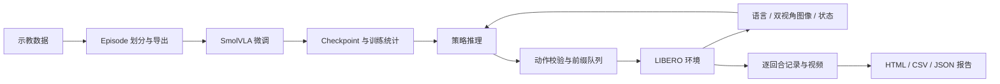

# MealVLA

**语言条件机械臂操作：从示教数据、策略微调到闭环评估。**

[](https://github.com/Hanamaki-CL/VLA/actions/workflows/ci.yml)

MealVLA 是基于 SmolVLA、LeRobot 和 LIBERO 的单臂操作实验框架，面向抓取与放置任务。输入语言指令、双视角图像和机器人状态，输出动作块，通过滚动执行与反馈观测完成仿真回合。项目提供数据处理、训练启动、推理控制、结果分析和实验归档的统一入口。

版本 **1.0.0** · [运行指南](docs/RUN_5090.md) · [命令参考](docs/CLI.md) · [架构](docs/ARCHITECTURE.md) · [版本说明](CHANGELOG.md)

## 核心能力

| 模块 | 实现 |
| --- | --- |
| 数据工程 | 按任务分层的 episode 级划分，独立导出训练/验证/测试集，保存数据 revision、统计量和源 episode 映射 |
| VLA 接入 | SmolVLA checkpoint 加载，双视角 RGB + 8 维状态输入，7 维动作反归一化 |
| 执行控制 | 动作块前缀执行、重新观测、维度与数值边界校验、动作有效期、有限次数重置重试 |
| 实验编排 | 一条命令串联数据、训练、评估，自动传递 checkpoint，保存实际配置和分阶段日志 |
| 结果分析 | 首次/最终成功率、Wilson 95% 区间、推理与控制耗时、失败原因、逐回合 CSV 和离线 HTML 报告 |
| 演示归档 | 可选双视角 MP4，每次重试单独保存，报告链接到对应视频 |
| 工程接口 | Python 包与 CLI、ROS 2 动作消息校验示例、GitHub Actions 核心测试与构建 |

模型结构和训练循环来自 [SmolVLA / LeRobot](https://github.com/huggingface/lerobot)。本仓库实现数据组织、观测与动作适配、执行约束、实验编排及报告。

## 架构



## 快速开始

### 查看执行与报告流程

核心包只依赖 NumPy，无需 GPU 或模型下载。以下示例使用固定动作的 mock 环境，生成明确标记为 **MOCK** 的报告：

```bash
git clone https://github.com/Hanamaki-CL/VLA.git
cd VLA
python -m pip install -e .
mealvla demo --output outputs/mock-demo
```

用浏览器打开 `outputs/mock-demo/report.html`。此路径用于检查接口和归档流程，不代表模型效果。

### RTX 5090 训练与仿真

目标环境为 Linux、Python 3.11、NVIDIA GPU。安装脚本使用 PyTorch 2.7.1 / CUDA 12.8 和 LeRobot 0.4.3。

```bash
bash scripts/setup_5090.sh
source .venv/bin/activate
export MUJOCO_GL=egl
mealvla doctor --cuda-check
mealvla pipeline --print-plan
bash scripts/run_5090.sh
```

默认运行三个 `libero_object` 任务、20,000 steps 微调、每任务 20 个仿真场景。流水线自动将训练输出接入评估。已有匹配数据时使用 `--reuse-data`；独立实验使用 `--output outputs/experiments/<name>`。输出目录必须是新目录。

FFmpeg、EGL、磁盘需求、分阶段命令及错误排查见[运行指南](docs/RUN_5090.md)。首次实际运行会下载上游数据和模型。

## 实验产物

```text
outputs/experiments/<name>/
├── pipeline.json          # 阶段状态、命令与来源
├── data-manifest.json     # 本次数据 revision 和划分
├── configs/               # 实际生效的配置快照
├── logs/                  # prepare / train / evaluate 日志
├── train/                 # LeRobot checkpoint
└── eval/
    ├── manifest.json      # 环境、版本与运行状态
    ├── episodes.jsonl     # 原始逐回合记录
    ├── summary.json       # 聚合指标
    ├── episodes.csv       # 表格分析记录
    ├── report.html        # 离线可视报告
    └── videos/            # 启用录制后生成
```

在 `configs/eval_libero.json` 中设置 `"record_video": true` 即可录制双视角视频。每段视频对应一个场景的一次尝试。编码会影响回合总耗时；推理、仿真 step 和录制开销分别记录。

评估中断时保留已完成场景和部分报告。成功率分母为已记录的场景数，重试不增加分母。默认协议属于自定义子集实验，详见[评估协议](docs/EXPERIMENTS.md)。

## 配置与命令

| 配置 | 用途 |
| --- | --- |
| `configs/pipeline_5090.json` | 关联各阶段配置，指定实验目录 |
| `configs/data.json` | 数据源、revision、任务和划分种子 |
| `configs/train_5090.json` | 模型、batch、训练步数、动作块长度 |
| `configs/eval_libero.json` | 场景数量、执行步数、超时、重试和视频 |

```bash
mealvla tasks --suite libero_object
mealvla prepare --config configs/data.json
mealvla train --config configs/train_5090.json
mealvla evaluate --config configs/eval_libero.json
mealvla report outputs/eval/mealvla_seed42_h10
```

流水线和独立阶段共用同一实现。更多选项见[命令参考](docs/CLI.md)。

## 工程结构

```text
src/mealvla/   数据、策略、执行器、实验编排、视频与报告
configs/      数据、训练、评估和流水线配置
scripts/      Linux 安装与运行脚本
ros2/         动作提案校验节点
tests/        数据契约、执行边界、报告与流程回归测试
docs/         架构、运行、命令与评估协议
.github/      托管 CI 工作流
```

GitHub Actions 在 Python 3.10–3.12 上执行核心测试、mock 视频/报告流程和包构建，保留运行产物。GPU 模型训练和 LIBERO 渲染不属于 CPU CI 的覆盖范围。

## 适用范围

1.0.0 提供单臂仿真实验的源码与运行工具；训练权重、实测成绩和真机部署不随源码发布。完整交付清单与验证口径见[版本与交付范围](docs/STATUS.md)。

执行器采用同步推理和有限场景重置，适用于离线仿真。ROS 2 节点用于动作消息校验，不连接机械臂控制器。真机控制、双臂协作及配餐专用场景不属于该版本范围。

## 许可

仓库代码采用 [MIT License](LICENSE)。模型、数据及依赖遵循各自许可，详见 [THIRD_PARTY_NOTICES.md](THIRD_PARTY_NOTICES.md)。
