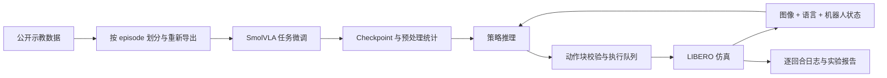

# MealVLA

**面向配餐应用的语言条件机械臂操作框架**

`SmolVLA` · `LeRobot` · `LIBERO` · `RTX 5090` · `Python` · `ROS 2 接口示例`

将视觉图像、语言指令和机器人状态连接到连续动作执行。MealVLA 围绕开源 SmolVLA 构建数据准备、任务微调、动作约束和仿真评估流程，探索传统机器人任务编排与学习型操作策略的结合。

应用动机来自配餐机器人的抓取、搬运和放置需求。首版使用 LIBERO 的公开单臂操作任务验证通用能力；配餐专用场景、称重和双臂操作属于后续扩展。

> **交付状态：代码与文档已编写，实验尚未运行。** 按项目要求，本次未安装依赖、执行测试、训练模型或运行仿真。仓库不包含训练权重、成功率结论或真机部署结果。可选 ROS 2 节点只做动作消息校验。

## 项目解决什么问题

- **从示教数据到训练：**按完整 episode 划分集合，再导出独立的 LeRobot 数据集，避免直接复用包含测试集信息的归一化统计。
- **从模型输出到执行：**模型预测动作块，执行器只消费前若干步，然后基于新观测重新规划；拒绝不合法或过期的动作。
- **从演示到可复现记录：**保存任务、初始状态、随机种子、执行配置、版本和逐回合结果，区分首次成功与重置重试后的成功。

## 系统结构



具体接口见 [架构说明](docs/ARCHITECTURE.md)。

## 在 RTX 5090 上使用

目标环境：Linux、Python 3.11、RTX 5090。仓库安装脚本选择 PyTorch 2.7.1 / CUDA 12.8 与 LeRobot 0.4.3；这是源码接口核对后的候选组合，仍需在目标机器验证。PyTorch 2.7 开始提供 Blackwell 和 CUDA 12.8 支持。[官方说明](https://pytorch.org/blog/pytorch-2-7/)

以下命令均在 **mealvla 项目根目录**执行：

```bash
# 1. 安装候选环境
bash scripts/setup_5090.sh
source .venv/bin/activate
export MUJOCO_GL=egl

# 2. 检查目标 GPU 和实际张量前向/反向
mealvla doctor --cuda-check

# 3. 查看任务，下载并按 episode 导出数据
mealvla tasks --suite libero_object
mealvla prepare --config configs/data.json

# 4. 微调
bash scripts/train_5090.sh

# 5. 检查并修改 configs/eval_libero.json 的 checkpoint 路径后评估
bash scripts/evaluate_5090.sh
mealvla report outputs/eval/mealvla_seed42_h10
```

数据和模型会在运行相应命令时从 Hugging Face 下载。默认不上传数据、权重或日志。数据导出、训练和评估均要求新的输出路径，避免覆盖已有成果。

安装细节、硬件注意事项和故障定位见 [RTX 5090 操作指南](docs/RUN_5090.md)。

## 不加载模型的工程演示

```bash
python -m pip install -e .
mealvla demo --output outputs/mock-demo
```

这个入口使用固定动作与标量环境，仅用于未来检查日志和执行流程。所有输出标记 `mock`，不能当作 VLA 或仿真任务成功率。调用真实模型失败时不会自动回退到 mock。

## 目录

```text
configs/                  数据、5090 训练、LIBERO 评估配置
src/mealvla/
  schemas.py              观测、动作和执行配置契约
  data.py                 episode 划分与独立数据集导出
  training.py             LeRobot 训练命令与来源记录
  policies.py             真实 SmolVLA / 显式 mock 策略
  envs.py                 LIBERO 状态和相机适配
  control.py              动作边界、时效和队列
  runner.py               分段执行与有限次数重置重试
  reports.py              成功率、区间、延迟和失败统计
  cli.py                  项目命令入口
ros2/                     dry-run 动作消息校验节点
scripts/                  5090 安装、训练、评估脚本
tests/                    可在目标环境执行的契约测试；本次未运行
docs/                     架构、复现、实验、简历、面试材料
```

## 怎样阅读结果

每次评估生成 `manifest.json`、`episodes.jsonl`、`summary.json`。

| 字段 | 含义 |
| --- | --- |
| `first_attempt_success_rate` | 每个初始场景的首次执行成功率 |
| `success_rate` | 允许配置内重置重试后的成功率 |
| `success_rate_ci95` | 以场景为分母的 Wilson 95% 区间 |
| `inference_ms` | 含输入处理、模型计算、CPU 回传的推理 p50/p95 |
| `control_step_ms` | 仿真一步调用耗时，不能当作真机控制延迟 |
| `reset_retries` | 重置并重新执行的总次数 |
| `complete` | 是否收集到全部计划场景 |
| `mock_only` | 是否只是工程联调数据 |

默认是 3 个任务 × 20 个初始状态的自定义子集实验，不代表完整 LIBERO benchmark。`realtime=false` 按模拟器推进，实际墙钟频率不保证为 20Hz。详见 [实验协议](docs/EXPERIMENTS.md)。

## 个人项目展示材料

- [项目介绍与贡献说明](docs/PROJECT_STORY.md)
- [简历项目经历](docs/RESUME_CN.md)
- [面试讲解与追问](docs/INTERVIEW_CN.md)
- [当前验证状态](docs/DELIVERY_STATUS.md)
- [开源来源](THIRD_PARTY_NOTICES.md)

项目新增代码采用 MIT 许可；模型、数据和依赖遵循各自上游许可。
