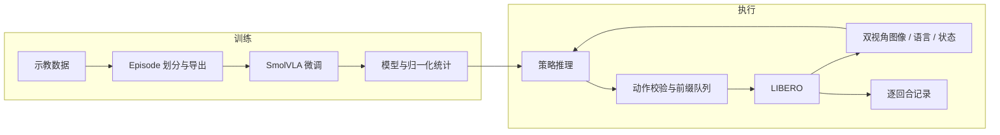

# MealVLA

语言条件机械臂操作：数据准备、SmolVLA 微调、动作执行与 LIBERO 评估。

MealVLA 面向配餐任务中的抓取与放置需求，将视觉—语言—动作模型接入机器人执行流程。当前以 LIBERO 单臂任务为实验环境，关注三个工程问题：示教数据如何划分，模型输出如何交给控制器，以及执行结果如何统计。

> 开发中：集成代码已提交，测试、GPU 训练和闭环仿真尚未完成运行验证。详见[项目状态](docs/STATUS.md)。

## 实现

- **数据准备**：按任务分层、按完整 episode 划分训练/验证/测试集；独立导出各子集，重新计算统计量；记录源数据 revision 和 episode 映射。
- **策略接入**：对接 SmolVLA checkpoint 及其预处理器，统一双视角图像、末端状态和七维控制输入。
- **动作执行**：每次预测一段动作，只执行指定前缀，再根据新观测推理；检查动作维度、数值范围和有效期。
- **评估记录**：保存逐回合结果，分别统计首次成功与重置重试后的成功率、推理延迟、失败原因和置信区间。
- **ROS 2 示例**：接收动作消息并返回校验结果，供接口联调使用，不连接真机控制器。

模型和训练循环使用 [SmolVLA / LeRobot](https://github.com/huggingface/lerobot)。本仓库负责数据组织、策略与环境适配、执行约束和评估流程。

## 架构



[输入输出约定与执行状态](docs/ARCHITECTURE.md)

## 开始使用

目标环境为 Linux、Python 3.11 和 NVIDIA GPU。安装脚本固定使用 LeRobot 0.4.3、PyTorch 2.7.1 / CUDA 12.8；训练配置以 RTX 5090 为目标，参数仍需根据实际显存调整。

```bash
git clone https://github.com/Hanamaki-CL/VLA.git
cd VLA
bash scripts/setup_5090.sh
source .venv/bin/activate
export MUJOCO_GL=egl
mealvla doctor --cuda-check
```

准备数据并启动训练：

```bash
mealvla tasks --suite libero_object
mealvla prepare --config configs/data.json
bash scripts/train_5090.sh configs/train_5090.json
```

训练完成后，在 `configs/eval_libero.json` 中填写实际 checkpoint 路径：

```bash
bash scripts/evaluate_5090.sh configs/eval_libero.json
mealvla report outputs/eval/mealvla_seed42_h10
```

首次运行会下载上游数据和模型。默认关闭 Hub 上传和 WandB；输出目录必须是新目录。环境依赖、数据占用和故障排查见[运行指南](docs/RUN_5090.md)。

## 配置

| 文件 | 作用 | 默认设置 |
| --- | --- | --- |
| `configs/data.json` | 数据来源和任务选择 | `libero_object`，任务 `[0,1,2]` |
| `configs/train_5090.json` | 微调参数 | batch 8，20,000 steps，chunk 50 |
| `configs/eval_libero.json` | 闭环执行与评估 | horizon 10，每任务 20 回合，重试 0 |

`chunk_size` 是模型预测长度，`horizon` 是每次实际执行的步数。减小 horizon 会更频繁地使用新观测，同时增加推理开销。

## 评估输出

每次运行生成三个文件：

```text
outputs/eval/<run>/
├── manifest.json     # 配置、依赖版本和运行状态
├── episodes.jsonl    # 每个场景的执行、重试和失败记录
└── summary.json      # 成功率、延迟分位数和置信区间
```

默认协议包含 3 个任务、60 个场景，属于自定义子集实验。首次成功率与允许重试后的成功率使用相同的场景分母；中断运行会标记为 `aborted`。推理延迟包含预处理和结果回传，仿真一步耗时单独记录。

实验设计、指标定义与结果状态见[评估协议](docs/EXPERIMENTS.md)。

## 开发

不加载模型时，可以使用 mock 策略检查执行和日志流程：

```bash
python -m pip install -e '.[dev]'
python -m pytest
mealvla demo --output outputs/mock-demo
```

Mock 使用固定动作和简化环境，输出标记为 `mock`，不用于模型效果评估。

```text
src/mealvla/   数据处理、策略适配、执行器和报告
configs/       数据、训练和评估配置
scripts/       Linux 环境与运行脚本
ros2/          动作消息校验示例
tests/         数据划分、执行约束和报告测试
docs/          架构、运行指南和实验协议
```

## 范围

当前实现使用同步推理和有限次数的场景重置重试。动作时效检查在推理返回后执行，不提供硬实时中断保证。配餐专用资产、双臂协作和 Flexiv 控制适配尚未实现。

## 许可

仓库代码采用 [MIT License](LICENSE)。模型、数据和第三方依赖遵循各自许可，详见 [THIRD_PARTY_NOTICES.md](THIRD_PARTY_NOTICES.md)。
