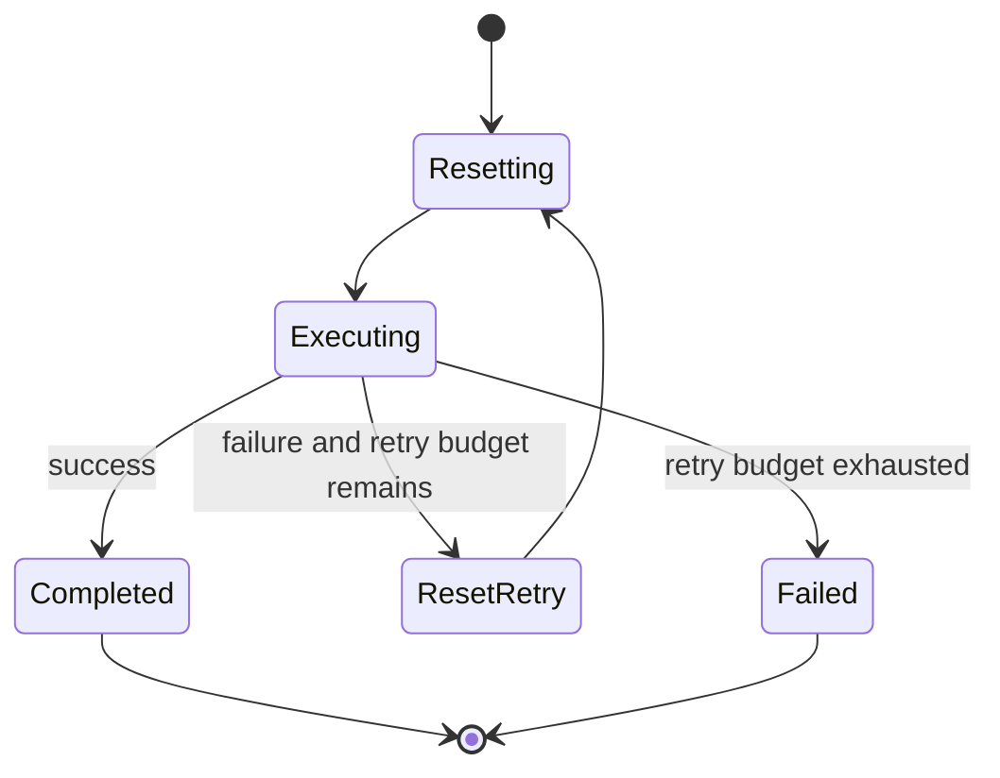

# 架构与接口

## 责任划分

LeRobot 提供 SmolVLA 实现、优化器/训练循环、预处理管线及 LIBERO 封装。MealVLA 实现任务数据准备、配置封装、执行约束、有限重试和实验记录。

## 观测契约

| 字段 | 格式 | 说明 |
| --- | --- | --- |
| `state` | float32 `[8]` | 末端位置 xyz、轴角 xyz、夹爪两个关节位置 |
| `images.image` | uint8 `[H,W,3]` | 第三人称 RGB 图像 |
| `images.image2` | uint8 `[H,W,3]` | 腕部 RGB 图像 |
| `instruction` | 非空字符串 | 使用数据集原始任务语言 |
| `timestamp` | monotonic 秒 | 在本进程内衡量观测和动作年龄 |

完整相机键为 `observation.images.image` 和 `observation.images.image2`。LIBERO 原始相机图像按 LeRobot 约定旋转 180 度；四元数使用 xyzw 顺序并转换成轴角。输入模型前转成 CHW、float32 `[0,1]`，再交给保存于 checkpoint 的预处理器。

状态布局在数据、checkpoint 和环境之间保持一致；更换机器人时需要同时调整状态定义和训练数据。

## 动作契约

`ActionChunk.actions` 为 `[T,7]`，对应 LIBERO 归一化控制输入：末端相对平移、相对旋转以及夹爪。它不是以米/弧度表示的通用真机命令；物理尺度由仿真控制器决定。

策略后处理先按训练统计还原动作，再检查形状、NaN/Inf、`[-1,1]` 边界和年龄。越界动作直接拒绝，仅允许浮点误差范围内的轻微裁剪。超出边界时应检查归一化统计、坐标系和控制模式。

首版输出动作块长度默认 50，执行前 10 步后重新观测推理。`horizon` 是执行步数，`chunk_size` 是模型预测长度；二者不是一个参数。

## 执行状态

失败处理采用有限次数的场景重置：从相同初始状态重新执行完整回合。默认重试次数为 0；开启后分别报告首次与最终成功率。原地重抓与视觉失败检测尚未实现。

推理采用同步调用。deadline 检查发生在推理返回后，超时动作被丢弃；它不能中断卡死的 GPU kernel。因此本执行器适用于离线仿真评估，不能充当真机独立 watchdog。真机需要独立控制进程和硬件停止机制。

## 训练数据隔离

按任务分层，将完整 source episode 划为约 80% / 10% / 10%，每个任务至少 3 个 episode。划分时不按帧随机抽样。

三个子集物理导出为独立的 LeRobot 数据集，每个子集重新计算统计。训练命令只接受导出的 `train` 目录，其 stats 用于训练并保存在 checkpoint 中；评估加载 checkpoint 的预处理统计，不用验证/测试集统计替换它。

导出过程保存源 dataset ID、解析后的 revision、原始与新 episode ID 映射。公开仿真初始状态与训练示教的对应关系未建立，故仿真成绩不宣称是完全未见初始状态的泛化结果。

## ROS 2 接口边界

`ros2/action_guard_node.py` 订阅 JSON 动作提案并输出校验回执，用于检查消息格式和动作时效。它不做相机同步、完整策略推理、轨迹跟踪或 Flexiv 驱动。

输入话题 `/mealvla/action_proposal`，输出 `/mealvla/action_validation`，类型均为 `std_msgs/String`。提案需要 `contract=libero_relative_v1`、`observed_at_unix`、`actions`。跨进程时间戳要求发布者和接收者时钟同步。接收端把年龄转换到本地 monotonic 时钟后校验。

迁移 Flexiv 需要重新定义观测/动作含义、单位、坐标系、标定、控制周期和限位；收集匹配数据并验证策略。不能把 LIBERO 的 7 个数值直接发送给机器人。
